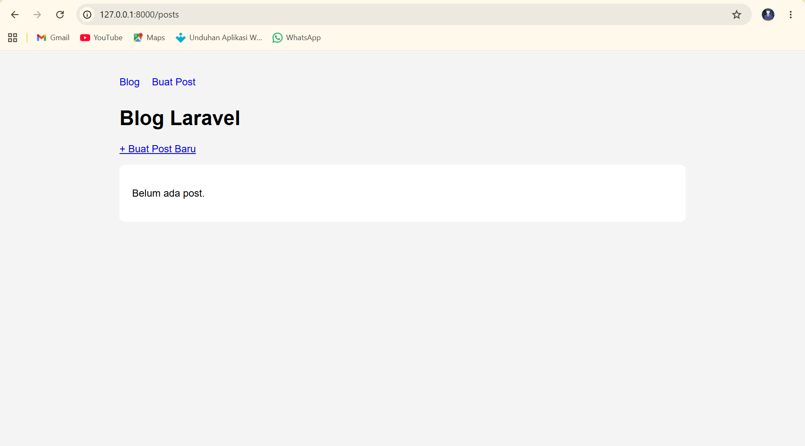

# Tugas Rutin 10 — Laravel Blog

## Identitas Proyek

- **Nama Tugas:** Tugas Rutin 10 — Laravel Blog
- **Repository:** `TugasWeb-P10-LaravelBlog`
- **Framework:** Laravel
- **Database:** MySQL
- **Tools:** PHP, Composer, MySQL/XAMPP, dan Visual Studio Code

## Deskripsi

Proyek ini merupakan aplikasi Blog CRUD menggunakan Laravel. Proyek dibuat untuk mempraktikkan routing, controller, HTTP methods, Blade Template, validasi form, dan pengelolaan data melalui database.

## Fitur

- Menampilkan daftar post.
- Menambahkan post.
- Melihat detail post.
- Mengedit post.
- Menghapus post.
- Validasi input.
- Penggunaan Blade Layout dan Components.
- Penggunaan route dan controller untuk mengelola data.
- Fitur pencarian post.
- Pagination pada hasil pencarian.

*Catatan: Fitur dicantumkan sesuai implementasi yang telah diselesaikan.*

## Teknologi

- PHP
- Laravel
- MySQL
- Blade Template Engine
- Composer

## Struktur Direktori

- `app/Http/Controllers/` — Logika aplikasi.
- `app/Models/` — Model untuk data.
- `database/migrations/` — Struktur tabel database.
- `database/seeders/` — Data awal jika digunakan.
- `resources/views/` — Tampilan aplikasi.
- `routes/web.php` — Definisi route.
- `public/` — Aset publik.

## Instalasi

1. Pastikan PHP, Composer, dan MySQL sudah terpasang.
2. Clone repository dan masuk ke folder proyek.
3. Pasang dependency:

   ```bash
   composer install
   ```

4. Salin `.env.example` menjadi `.env`.
5. Buat database MySQL dan sesuaikan konfigurasi `.env`.
6. Buat application key:

   ```bash
   php artisan key:generate
   ```

7. Jalankan migration:

   ```bash
   php artisan migrate
   ```

8. Jalankan server:

   ```bash
   php artisan serve
   ```

9. Buka `http://127.0.0.1:8000`.

Jika proyek menggunakan data awal dari seeder, jalankan seeder yang tersedia sesuai konfigurasi proyek.

## Screenshot



## Pengujian

Pastikan operasi Create, Read, Update, dan Delete berjalan. Uji pula validasi input, pencarian, dan pagination.

## Keamanan

File `.env` tidak disertakan dalam repository. Konfigurasi database harus disesuaikan pada lingkungan lokal masing-masing.

## Repository

`TugasWeb-P10-LaravelBlog`
